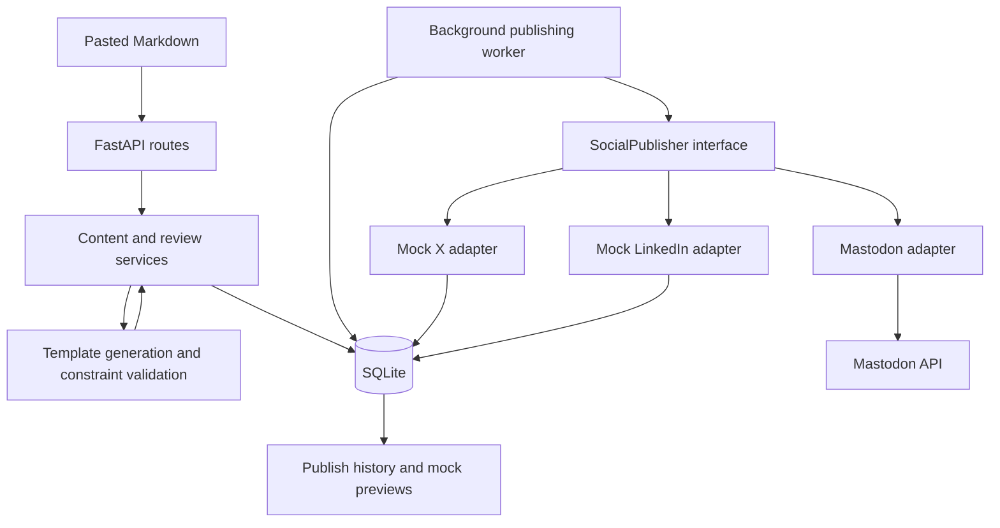

# Social Media Studio

Social Media Studio turns a blog post into platform-specific drafts that a human can review, approve, and schedule for publishing.

## Current status

Markdown ingestion, template generation, review, persistent scheduling, mock publishing, publish history, and bounded retries are implemented. The Mastodon adapter has offline HTTP tests. Live Mastodon credential verification and publishing are awaiting account approval.

The current test suite contains 29 tests. The latest developer-run suite passed all 29.

The combined launcher has been manually verified on Windows. After `Ctrl+C`, port `8000` was closed and the worker process had exited.

## Architecture



Routes translate HTTP requests and errors. Services enforce workflow rules. Repositories handle database queries. Publisher adapters share a `publish(text, idempotency_key)` interface.

## Setup

The project is developed with Python 3.14 on Windows PowerShell 5.1. Run the following commands from the repository root after cloning.

```powershell
git clone https://github.com/vuchau0802/social-media-studio.git
cd social-media-studio
py -m venv .venv
.\.venv\Scripts\python.exe -m pip install -r requirements.txt
```

The API, seed script, and worker initialize the SQLite tables automatically. The database is stored at `studio.db` in the repository root.

### Start the API and worker together

Run the following command from the repository root and leave the terminal open.

```powershell
.\.venv\Scripts\python.exe -m scripts.run
```

The API and worker share one terminal. Press `Ctrl+C` in that terminal to stop both. If either child process exits, the launcher stops the other process.

Open [interactive API documentation](http://127.0.0.1:8000/docs) to inspect the endpoints and request schemas.

### Start the API separately

In the first PowerShell window, run the following command and leave it running.

```powershell
.\.venv\Scripts\python.exe -m uvicorn main:app --reload
```

### Start the worker separately

Open a second PowerShell window in the repository root and leave this command running.

```powershell
.\.venv\Scripts\python.exe -m app.worker
```

The worker checks for due jobs every two seconds when idle. Use `Ctrl+C` in each window to stop its process.

### Create sample data

In another PowerShell window at the repository root, run the seed command.

```powershell
.\.venv\Scripts\python.exe -m scripts.seed
```

Each run creates a fresh sample article and three platform drafts, then prints their IDs and content as JSON. Every generated variant starts as `draft`.

## Try the mock publishing workflow

With the API and worker running, use this example from another PowerShell window. It creates fresh sample data and selects its Mock X draft, so the example works with an existing database.

```powershell
$seed = (.\.venv\Scripts\python.exe -m scripts.seed | Out-String) | ConvertFrom-Json
$variant = $seed.variants | Where-Object { $_.platform -eq 'mock_x' }

Invoke-RestMethod -Method Post `
    -Uri "http://127.0.0.1:8000/variants/$($variant.id)/approve"

$publishAt = [DateTimeOffset]::UtcNow.AddMinutes(2).ToString('o')
$scheduleBody = @{ scheduled_at = $publishAt } | ConvertTo-Json

Invoke-RestMethod -Method Post `
    -Uri "http://127.0.0.1:8000/variants/$($variant.id)/schedule" `
    -ContentType 'application/json' `
    -Body $scheduleBody
```

After the scheduled time, inspect the history.

```powershell
Invoke-RestMethod -Uri 'http://127.0.0.1:8000/publish-history' |
    ConvertTo-Json -Depth 5
```

A successful mock attempt includes a preview path such as `/mock-publications/1`. Request the returned path to inspect the stored publication.

Repeating the scheduling request with the same variant and future timestamp returns the existing job and idempotency key. Generating variants again creates a fresh batch of drafts.

## Review and platform rules

Variants use the statuses `draft`, `approved`, `rejected`, and `published`. Approval and rejection apply to drafts. A valid edit to an editable variant resets its status to `draft`, requiring fresh approval. Once a variant has a scheduled job, its text is locked.

Only approved variants can be scheduled. Publish times must include a timezone and be in the future. Times are normalized to UTC before storage.

These limits are application constraint profiles.

| Platform | Maximum characters | Maximum hashtags | Maximum exclamation marks |
| --- | --- | --- | --- |
| Mock X | 280 | 2 | 1 |
| Mock LinkedIn | 600 | 3 | 0 |
| Mastodon | 400 | 3 | 2 |

Validation applies to generated text, edits, and approval. An invalid generated draft blocks the entire batch from being saved.

## Mastodon configuration

Real publishing uses an account you own on a server that permits bots. Create an application with `write:statuses` and `read:accounts` permissions once the account is approved.

Create a local `.env` file from the example if one does not already exist.

```powershell
if (-not (Test-Path -LiteralPath .env)) {
    Copy-Item -LiteralPath .env.example -Destination .env
}
```

Fill in your server origin and application access token.

```dotenv
MASTODON_BASE_URL=https://your-server.example
MASTODON_ACCESS_TOKEN=your_actual_access_token
```

`MASTODON_BASE_URL` must be an HTTPS server origin. Process environment variables override `.env` values. Mock adapters can run while Mastodon credentials are unavailable. Credentials are read when the Mastodon adapter is selected.

Keep the token in the ignored `.env` file. Commit placeholder values in `.env.example`.

Verify the account credentials with this command.

```powershell
.\.venv\Scripts\python.exe -m scripts.verify_mastodon
```

The script prints the verified account name and server. Verification performs an account lookup. After successful verification, approve a `mastodon` variant and schedule it through the same API used for mock variants. The adapter currently publishes with followers-only visibility, represented by `private` in the Mastodon API.

Live Mastodon verification and a real scheduled publish remain pending while account approval is outstanding.

## Reliability behavior

- A unique `(variant_id, scheduled_at)` constraint identifies each scheduled slot. Each job stores a snapshot of the approved text and platform plus a stable idempotency key.
- Mock publications enforce uniqueness per platform and key. Reusing a key with different text raises an error.
- Workers claim jobs transactionally using 60-second leases. Expired claims can be recovered, and stale workers cannot record completion or schedule retries.
- Each claimed attempt is stored with an outcome of `started`, `success`, `failed`, or `interrupted`. Successful completion updates the attempt, job, and variant in one transaction.
- Retryable failures persist their next attempt time. The worker respects provider delay headers and exponential backoff. The original scheduled slot and key remain stable across retries.
- Automatic publishing is limited to five total attempts within 30 minutes of the first attempt, including interrupted attempts. Jobs that exhaust either limit become `failed` and require reconciliation before another publish.

Mastodon documents idempotency-key retention of up to one hour. The local retry bounds limit the recovery window. Real-provider duplicate prevention still depends on the server honoring the key. [Mastodon publishing documentation](https://docs.joinmastodon.org/methods/statuses/)

## API endpoints

| Method | Path | Purpose |
| --- | --- | --- |
| POST | `/posts` | Store pasted Markdown |
| GET | `/posts/{post_id}` | Retrieve the source article |
| POST | `/posts/{post_id}/variants` | Generate and save platform drafts |
| GET | `/posts/{post_id}/variants` | List saved variants |
| PATCH | `/variants/{variant_id}` | Validate and edit text |
| POST | `/variants/{variant_id}/approve` | Approve a draft |
| POST | `/variants/{variant_id}/reject` | Reject a draft |
| POST | `/variants/{variant_id}/schedule` | Schedule an approved variant |
| GET | `/mock-publications/{publication_id}` | Retrieve a mock preview |
| GET | `/publish-history` | List publishing attempts |

Missing records return `404`. Input validation errors return `422`. Workflow conflicts, including scheduling an unapproved variant or editing scheduled text, return `409`.

## Tests

```powershell
.\.venv\Scripts\python.exe -m unittest discover -s tests -v
```

The current suite covers content generation, blocked variants, configuration precedence, Mastodon HTTP requests, rate-limit parsing, bounded retries, leases, and recovery after an abrupt process exit. Tests use temporary databases and simulated Mastodon responses. Two worker tests intentionally emit retryable-failure log messages.

## Project structure

```text
app/
  main.py                 Application startup, error handling, and router registration
  config.py               Mastodon settings
  database.py             SQLite connections and initial schema
  schemas.py              Request models
  generator.py            Template-based text generation
  profiles.py             Platform constraints and validation
  routes/                 HTTP endpoints
  services/               Content, review, scheduling, and retry rules
  repositories/           Database queries and transactional worker operations
  publishers/             Shared publisher interface and platform adapters
scripts/
  run.py                  Combined API and worker launcher
  seed.py                 Sample article and draft creation
  verify_mastodon.py      Account credential verification
tests/                    Automated regression tests
main.py                   Uvicorn entry point
```
